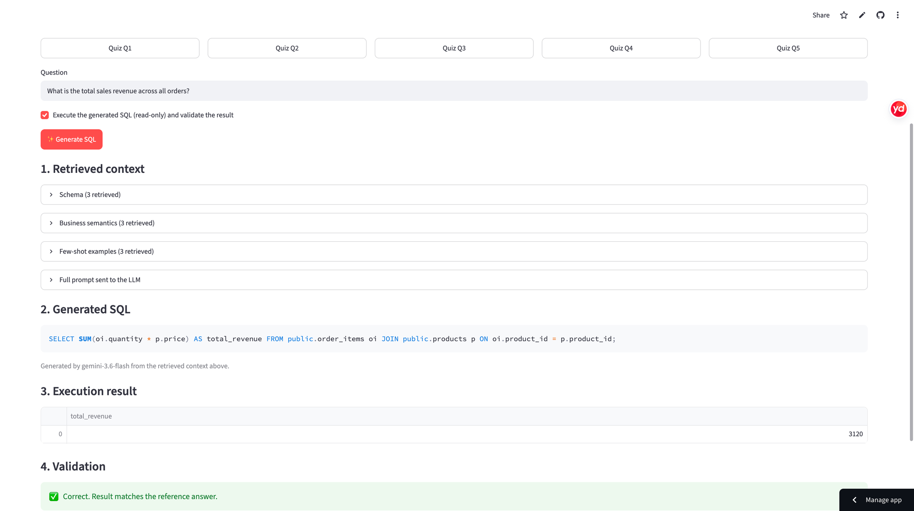
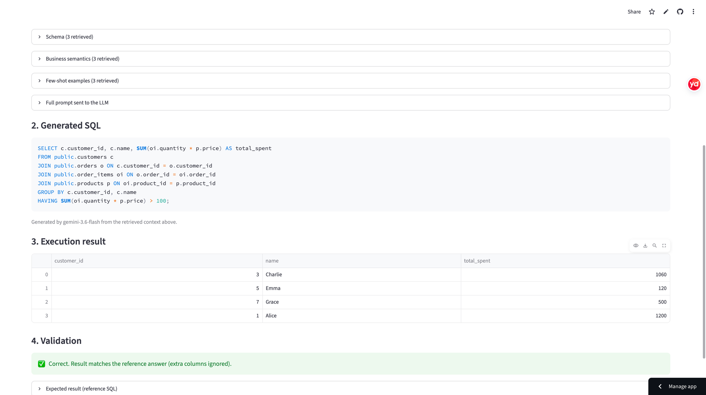

# Online Store SQL Quiz + RAG Text-to-SQL

**Week 7: SQL Quiz with Supabase · Week 8: RAG-Powered Text-to-SQL**

An interactive SQL quiz application built with Python, Streamlit, Supabase PostgreSQL, Supabase Authentication, and GitHub Actions.

## Week 8: RAG-Powered Text-to-SQL

**Deployed app:** https://sql-quiz-week7.streamlit.app/ — open the **🤖 Text-to-SQL (RAG)** tab. No login is needed for this tab; the original SQL Quiz is in the second tab.

### Architecture

```text
Question ──► Gemini embedding (RETRIEVAL_QUERY) ──► ChromaDB similarity search
                                                        │  top-3 schema docs
                                                        │  top-3 business-semantics docs
                                                        │  top-3 few-shot examples
                                                        ▼
                          Prompt = retrieved schema + rules + examples + question
                                                        ▼
                               Gemini (gemini-2.5-flash) ──► SQL
                                                        ▼
        (extra credit) read-only execution on Supabase PostgreSQL ──► result table ──► validation
```

| Component | Choice |
|---|---|
| Database | Supabase PostgreSQL (Week 7), queried through the read-only `quiz_reader` role |
| Vector database | ChromaDB (in-process, cosine similarity), rebuilt at app start |
| Embeddings | Google `gemini-embedding-001` (768 dimensions) |
| LLM | Google Gemini `gemini-2.5-flash` via the Gemini API |
| Web app | Streamlit Community Cloud |

**What is stored in the vector database** (`rag/knowledge.py`):

1. **Database schema** – one document per table (columns, types, foreign keys), introspected live from PostgreSQL (`information_schema` / `pg_constraint`).
2. **Business semantics** – rules such as "revenue = SUM(quantity × price), including Pending orders" and valid `status` values.
3. **Few-shot examples** – 12 question/SQL pairs (the question is embedded, the SQL is stored as metadata). They intentionally differ from the five quiz questions.

At query time the question is embedded and ChromaDB is searched separately for each knowledge type (`rag/engine.py: retrieve`). The retrieved documents, and only those, are placed in the prompt, and the UI shows the retrieved items with similarity scores and the full prompt.

**Extra credit (implemented):** the generated SQL is executed with the same read-only machinery as the quiz (single `SELECT`, read-only transaction, 5 s timeout, 100-row cap). For the five quiz questions the result is compared with the reference SQL's result (ignoring row order, column names and extra columns) and a ✅/❌ outcome is shown. The reference SQL is never given to the LLM.

### Run locally

```bash
git clone https://github.com/hanhan572/sql-quiz-week7.git
cd sql-quiz-week7
pip install -r requirements.txt
cp .streamlit/secrets.toml.example .streamlit/secrets.toml   # then fill in real values
streamlit run app.py
```

`secrets.toml` additionally needs `GEMINI_API_KEY` (free at https://aistudio.google.com/apikey). On Streamlit Community Cloud, add the same keys under *App settings → Secrets*. Secrets and `.env` files are git-ignored and never committed.

### Screenshots

**Question → retrieved context → generated SQL**



**Executed SQL, result table, and validation**



---

# Week 7: SQL Quiz

## Live Application

**Quiz Website:** https://sql-quiz-week7.streamlit.app/

**GitHub Repository:** https://github.com/hanhan572/sql-quiz-week7

The application allows students to sign in, answer SQL questions, execute read-only queries against a hosted PostgreSQL database, view live query results, and save their answers.

## 1. Project Overview

This project simulates a teaching assistant's SQL quiz platform. Students practice SQL using a real online store database hosted on Supabase.

The quiz consists of five questions worth 20 points in total. Each question includes a reference SQL query and an expected result.

### Technologies Used

| Technology | Purpose |
|---|---|
| Supabase PostgreSQL | Hosted relational database |
| Supabase Auth | Email and password authentication |
| Streamlit | Interactive web application |
| Python | Application logic |
| Psycopg | PostgreSQL database connection |
| Pandas | Display SQL query results |
| GitHub Actions | Automated database connection testing |
| GitHub Secrets | Secure storage of database credentials |

## 2. Database Design

The application uses four sample sales tables:

| Table | Description | Sample Rows |
|---|---|---:|
| `customers` | Customer IDs, names, and states | 8 |
| `products` | Product information and prices | 5 |
| `orders` | Orders, customers, and order statuses | 10 |
| `order_items` | Products and quantities associated with orders | 11 |

Two additional tables support the quiz:

- `quiz_questions`: Stores questions, points, reference SQL queries, and expected results.
- `quiz_answers`: Stores each student's submitted SQL and last update timestamp.

Foreign keys connect orders to customers, order items to orders and products, and saved answers to authenticated users and quiz questions.

## 3. SQL Quiz

**Topic:** Online Store Sales Analysis

| Question | SQL Concepts | Points |
|---|---|---:|
| Q1. Find California customers | SELECT, WHERE | 4 |
| Q2. Count orders by status | GROUP BY, COUNT | 4 |
| Q3. Calculate total sales revenue | JOIN, SUM | 4 |
| Q4. Find the top three most expensive products | ORDER BY, LIMIT | 4 |
| Q5. Find customers spending over $100 | JOIN, GROUP BY, HAVING | 4 |
| **Total** | | **20** |

Each question includes a hint containing the reference SQL query and expected output.

Revenue and total spending are calculated across all orders, including Pending orders.

Students may write SQL queries that differ from the reference solution as long as their result sets are correct.

## 4. How to Use the Application

1. Open https://sql-quiz-week7.streamlit.app/
2. Select **Sign up** to create an account, or **Sign in** if you already have one.
3. Confirm your email if required.
4. Select one of the five questions.
5. Read the question and enter a SQL query in the editor.
6. Click **Run SQL** to execute the query against the hosted PostgreSQL database.
7. Review the live result table.
8. Open **Hint / Answer key** to compare the query and expected result.
9. Click **Save answer** to save your SQL submission.
10. Select another question to continue.

The application supports saving and retrieving answers associated with the authenticated user.

## 5. Authentication and Access Control

Supabase Auth provides email and password authentication.

Users must sign in before they can access the quiz's query execution and answer-saving features.

The Streamlit application verifies the user's access token through Supabase Auth.

Row Level Security (RLS) is enabled for the quiz answer table. Policies restrict students to accessing and modifying their own saved answers.

The quiz questions table permits authenticated users to read questions.

## 6. SQL Execution and Security

Student SQL is executed against the hosted PostgreSQL database using a dedicated `quiz_reader` database role.

The role is granted SELECT permissions on the four practice tables.

The application restricts execution to a single read-only SELECT query and uses PostgreSQL read-only transactions.

Additional safeguards include:

- SSL-enabled database connections (`sslmode=require`)
- Statement timeout of five seconds
- A maximum of 100 displayed result rows
- Restricted database permissions
- Server-side authentication checks
- Supabase RLS policies

The application does not use database administrator credentials to execute student queries.

Database passwords are not stored in the repository.

## 7. GitHub Actions and Secrets

The project includes a GitHub Actions workflow:

`.github/workflows/database-check.yml`

The workflow runs a Python script:

`scripts/check_database.py`

The workflow installs the required PostgreSQL driver and runs a connection test against the hosted Supabase PostgreSQL database.

The database password is supplied through the GitHub repository secret:

`DB_PASSWORD`

The workflow does not contain a hard-coded database password.

GitHub Actions can run automatically on pushes to the main branch or manually through the Actions tab.

**Workflow:** Supabase Database Check

## 8. Project Structure

```text
sql-quiz-week7/
├── .github/
│   └── workflows/
│       └── database-check.yml
├── .streamlit/
│   └── secrets.toml.example
├── rag/
│   ├── knowledge.py      # schema, business semantics, few-shot examples
│   └── engine.py         # ChromaDB retrieval, Gemini generation, validation
├── scripts/
│   └── check_database.py
├── app.py
├── requirements.txt
├── .gitignore
└── README.md
```

## 9. Setup Instructions

### Prerequisites

- Python 3.11 or later
- A Supabase project with PostgreSQL and Auth
- A database role with read-only access to practice tables

### Install dependencies

Clone the repository and install Python packages:

```bash
git clone https://github.com/hanhan572/sql-quiz-week7.git
cd sql-quiz-week7
pip install -r requirements.txt
```

### Configure application secrets

Create a local `.streamlit/secrets.toml` file using `.streamlit/secrets.toml.example` as a template.

Configure the Supabase project URL, Publishable Key, and PostgreSQL Session pooler connection parameters.

Use the dedicated read-only database role and configure SSL.

Do not commit the real secrets file to GitHub.

For Streamlit Community Cloud, configure the same values in the application's Secrets settings.

### Start the application

```bash
streamlit run app.py
```

The application starts a local Streamlit server.

## 10. Testing

The application has been tested for the following operations:

- Successful Supabase email/password login
- Loading SQL questions from Supabase
- Executing a SQL query against live PostgreSQL data
- Displaying returned database rows
- Saving a student's SQL answer
- Successful GitHub Actions workflow execution

Example query:

```sql
SELECT *
FROM public.customers
WHERE state = 'CA';
```

Expected result:

| customer_id | name | state |
|---|---|---|
| 1 | Alice | CA |
| 3 | Charlie | CA |
| 5 | Emma | CA |

## 11. Submission

**Repository URL:** https://github.com/hanhan572/sql-quiz-week7

**Live Quiz URL:** https://sql-quiz-week7.streamlit.app/

This project demonstrates hosted PostgreSQL integration, authenticated application access, live SQL execution, answer persistence, and automated database connectivity testing using GitHub Actions.
